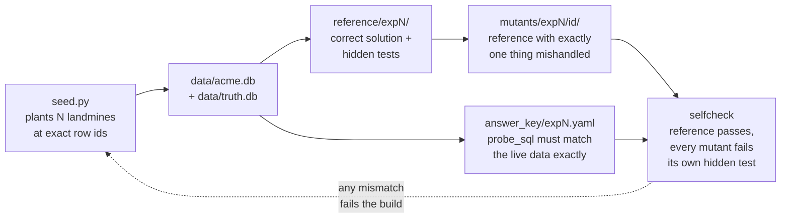

# Acme Analytics — full data model

This is the database the rig seeds (`data/acme.db`): 16 tables, 2 views, 1 index, 2 triggers, modeling a toy
e-commerce business across five sales channels (`web`, `mobile`, `marketplace`, `pos_v2`, `eu_legacy`).

```mermaid
erDiagram
    REGIONS {
        int region_id PK
        string name
        int parent_id FK "self-ref, nullable"
    }
    CUSTOMERS {
        int customer_id PK
        string email "case/whitespace/invisible-char dup risk"
        string full_name
        string phone "nullable"
        int region_id FK "nullable"
        string status
        string created_at
        string updated_at "rewritten by trigger"
        string legacy_id "nullable"
        string source_system "web/mobile/marketplace/pos_v2/eu_legacy"
    }
    CUSTOMER_ADDRESSES {
        int address_id PK
        int customer_id FK "ON DELETE CASCADE"
        string line1
        string city
        string postal_code
        bool is_primary
        string updated_at
    }
    CATEGORIES {
        int category_id PK
        string name
    }
    PRODUCTS {
        int product_id PK
        string sku
        string name
        int category_id FK
        real list_price
    }
    ORDERS {
        int order_id PK
        int customer_id "NO FK -- orphan risk"
        string order_date "ISO + DD/MM + MM/DD mixed"
        string amount "TEXT -- symbols/commas/sci notation/sentinels"
        string currency "nullable"
        string status "case/spelling variants"
        string source_system
    }
    ORDER_ITEMS {
        int item_id PK
        int order_id FK
        int product_id FK
        int quantity
        string unit_price "TEXT"
        real discount_pct "nullable"
    }
    PAYMENTS {
        int payment_id PK
        int order_id FK
        real amount "several rows per order"
        string status "captured/failed/pending"
        string paid_at
    }
    REFUNDS {
        int refund_id PK
        string order_id "NO FK -- int, 'ORD-id', or unmatched"
        int customer_id "nullable, NO FK"
        string amount "TEXT"
        string refunded_at
    }
    SESSIONS {
        int session_id PK
        int customer_id "NO FK"
        string login_ts "nullable"
        string device
    }
    LEGACY_CUSTOMER_MAP {
        int map_id PK
        string legacy_id
        int customer_id "NO FK"
    }
    CUSTOMERS_AUDIT {
        int audit_id PK
        int customer_id "NO FK, trigger-written"
        string action
        string changed_at
    }
    CUSTOMERS_MERGE_LOG {
        int merge_id PK
        int survivor_id "NO FK"
        int merged_id "NO FK"
        string merged_at
        string details
    }
    CUSTOMER_LTV {
        int customer_id PK "NO FK, cached table"
        int order_count
        real lifetime_value
        string refreshed_at
    }
    ORDERS_AMOUNT_QUARANTINE {
        string order_id "NO FK, added by migration 005"
        string original_amount
        string reason
    }
    SCHEMA_MIGRATIONS {
        string version PK
        string name
        string applied_at
    }

    REGIONS ||--o{ REGIONS : "parent_id rollup"
    REGIONS ||--o{ CUSTOMERS : "region_id (nullable)"
    CUSTOMERS ||--o{ CUSTOMER_ADDRESSES : "FK, CASCADE delete"
    CUSTOMERS ||--o{ ORDERS : "NO FK"
    CUSTOMERS ||--o{ SESSIONS : "NO FK"
    CUSTOMERS ||--o{ LEGACY_CUSTOMER_MAP : "NO FK"
    CUSTOMERS ||--o{ CUSTOMERS_AUDIT : "NO FK, trigger"
    CUSTOMERS ||--o| CUSTOMER_LTV : "NO FK, cache table"
    CUSTOMERS ||--o{ REFUNDS : "nullable, NO FK"
    CUSTOMERS ||--o{ CUSTOMERS_MERGE_LOG : "survivor_id, NO FK"
    CUSTOMERS ||--o{ CUSTOMERS_MERGE_LOG : "merged_id, NO FK"
    CATEGORIES ||--o{ PRODUCTS : "FK"
    PRODUCTS ||--o{ ORDER_ITEMS : "FK"
    ORDERS ||--o{ ORDER_ITEMS : "FK"
    ORDERS ||--o{ PAYMENTS : "FK, 1-to-many"
    ORDERS ||--o{ REFUNDS : "text match, NO FK"
    ORDERS ||--o{ ORDERS_AMOUNT_QUARANTINE : "logical link, NO FK"
```

## Why it looks like this

Every "NO FK" relationship above is **intentional**, not an oversight — it mirrors how data actually looks
after years of mergers, legacy migrations, and point-of-sale integrations at a real company. That's the
point of the rig: an agent has to notice these on its own, the same way it would on a real codebase, instead
of being told where to look.

| Design choice | Why it's realistic | What goes wrong if ignored |
|---|---|---|
| `orders.customer_id`, `refunds.order_id`, `sessions.customer_id`, `legacy_customer_map.customer_id` have no FK | Legacy/pos_v2/eu_legacy imports rarely enforce referential integrity | Deleting or merging a customer can silently orphan rows in four different tables |
| `orders.amount`, `order_items.unit_price`, `refunds.amount` are `TEXT`, not numeric | Money arrives as strings from five different source systems with five different conventions | Naive `CAST(... AS REAL)` silently turns unparseable text into `0` or `NULL` and nobody notices |
| `refunds.order_id` is sometimes `'ORD-123'`, sometimes a plain int, sometimes unmatched | A refund system migration that didn't backfill cleanly | A plain `JOIN` silently drops ~2% of refunds — revenue reports look fine but are wrong |
| `customers.email` isn't unique and tolerates case/whitespace/invisible Unicode variants | Real signup forms never normalize input | The same person appears as 2–3 "different" customers; revenue and rankings split across them |
| `orders.order_date` mixes ISO, `DD/MM/YYYY`, and `MM/DD/YYYY` | One source system per date convention, never reconciled | Two formats are valid for any day ≤ 12 — a date can be silently misread by exactly one month |
| `orders.status` has `Cancelled`/`CANCELED`/`canceled` | Different systems, different casing conventions, never normalized | A case-sensitive filter double-counts or miscounts "cancelled" orders |
| `customer_addresses` has `ON DELETE CASCADE` | Looks like responsible schema design | It silently deletes a customer's most recent address the moment someone merges or removes that customer row, if foreign keys are enabled |
| `payments` allows several rows per order (split payments, retried captures) | Real payment processors do this | A query that joins `orders` → `order_items` → `payments` without aggregating first fans out and inflates totals |

## Where the complexity really lives

The database itself is the least complex part of this project. The real complexity is in keeping five things
in exact agreement with each other for every planted problem:

A single off-by-one in the seeder (an id landing on a round number, a count drifting by one) breaks the
answer key, the mutant, or the selfcheck — which is exactly what happened repeatedly while building this: see
`STATUS.md` for the issues that surfaced and how they were resolved, and what's still unverified because it
has never been run against a real agent.
