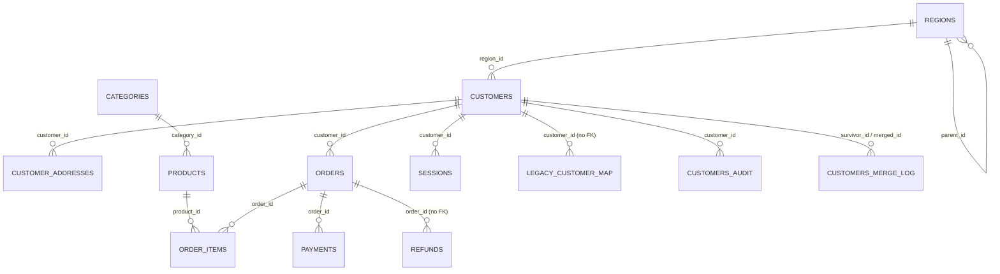

# Experimentation rig architecture

## Purpose

Two agents (Engineer, Tester) work independently on a toy e-commerce repo, `acme_analytics/`, and its
SQLite database, `data/acme.db`. An Orchestrator runs each pair's patches on a throwaway clone and scores
which planted problems the Tester's suite actually catches. The agents never see `rig/`, the reference
solutions, or the answer key.

## Data model



`orders.amount` is TEXT (Experiment 1's subject). `orders.customer_id` and `refunds.order_id` have no
foreign key, by design. Views `v_orders_clean` and `v_monthly_revenue`, an index on `orders(amount)`, and a
trigger that writes `customers_audit` on customer changes all depend on `orders` and must survive any rebuild.

## Layout

```
experimentation_rig/
  rig/                         the harness and the answer keys (never shown to agents)
    cli.py  common.py  seed.py  snapshot.py  readonly.py  workspace.py  run.py
    score.py  selfcheck.py  tellscan.py  mutgen.py  invariants.py  drivers.py  drivers_exp23.py
    tickets/expN.md            vague ticket text given to agents
    contracts/expN.md          the approved, policy-level contract given to agents
    answer_key/expN.yaml       per-landmine id, tier, probe_sql, expected count, exposed_by, mutant path
    reference/expN/            known-correct solution + hidden tests (never shown to agents)
    mutants/expN/<id>/         the reference with exactly that landmine mishandled (generated by mutgen.py)
  acme_analytics_template/     pristine toy repo (never edited after generation)
  acme_analytics/              the working copy agents edit (regenerated by `reset`)
  data/                        acme.db, truth.db (seeder ground truth), snapshots/, work/
  docs/rig-architecture.md     this file
```

## Agent-facing API

```python
from experimentation_rig.rig.workspace import build, schema_text
from experimentation_rig.rig.run import run_in_clone

files = build(ticket_id, role)       # role: "engineer" | "tester"
schema = schema_text(ticket_id)      # schema dump for prompts

result = run_in_clone(ticket_id, engineer_files, tester_files)
# result.passed, result.failures (test/message/input/expected/actual), result.work_db
```

`run_in_clone` copies the pristine template into `data/work/<ticket>-<id>/repo`, applies the engineer's and
tester's files (path-allowlisted: engineer to `migrations/`, `queries/`, `src/`; tester to `tests/`), copies
the ticket's frozen snapshot to a work database and a read-only `before.db`, applies pending migrations, and
runs pytest with its own `pytest.ini`, an explicit `--rootdir`/`--confcutdir`, and `-p no:cacheprovider` so
nothing from the host repo leaks in. The clone is deleted unless `keep_db=True`.

Agents never query the database directly; `rig.readonly.query(ticket, sql, max_rows, timeout)` accepts a
single `SELECT` against a read-only snapshot, with row and time limits and a SQL authorizer restricting it to
read-only operations.

## Scoring

`rig.score.score(ticket, engineer_files, tester_files)`:

1. Runs the Tester's suite against the **reference** solution — tests that fail here are **false alarms**.
2. Runs the Engineer's patch against the **hidden reference tests** — pass/fail is reported separately.
3. For each landmine, runs the Tester's suite against that landmine's **mutant** (reference with exactly that
   one thing mishandled). The landmine is **caught** if some test fails on the mutant while it passed on the
   reference.
4. Also evaluates each landmine's `exposed_by` generic invariants (row counts, reconciliation, orphan checks,
   ties, boundary cases) against the mutant run, and reports which ones fired.

Report fields: `caught`, `total`, `catch_rate`, `catch_rate_by_tier`, `false_alarms`,
`tester_suite_passes_on_reference`, `engineer_passes_hidden_tests`, and per-landmine `caught_by_tests` /
`invariants_fired`.

## Landmine catalog

### Experiment 1 — `orders.amount` TEXT → numeric (11 landmines)

| id | tier | what |
|---|---|---|
| L1-01 | T2 | currency symbols and thousands commas |
| L1-02 | T2 | scientific notation |
| L1-03 | T3 | `eu_legacy` decimal commas, ambiguous `'1,200'` |
| L1-04 | T2 | accounting negatives `'(50.00)'` |
| L1-05 | T2 | blanks (`''`, `' '`, `'null'`, `'N/A'`) vs real `NULL` |
| L1-06 | T3 | invisible characters (NBSP, ZWSP, tab) |
| L1-07 | T3 | `pos_v2` whole-cent integers, 100x wrong |
| L1-08 | T3 | sentinels `-1` / `-999` (real amount is in `payments`) |
| L1-09 | T4 | embedded currency codes (`'USD 12.00'`) |
| L1-10 | T2 | three-decimal values needing a rounding policy |
| L1-11 | T2 | the rebuild must keep the view/index/trigger alive |

Deliverable: migration `005` (up/down) rebuilding `orders.amount` as `REAL`, quarantining unconvertible values
in `orders_amount_quarantine` instead of dropping or zeroing them.

### Experiment 2 — best customers per region (12 landmines)

| id | tier | what |
|---|---|---|
| L2-01 | T3 | multiple payment rows per order can fan-out a naive join |
| L2-02 | T3 | refunds referencing `'ORD-<id>'`, and some referencing missing orders |
| L2-03 | T2 | `NULL` region → must report as `'Unassigned'`, not dropped |
| L2-04 | T4 | exact ties at rank 3 |
| L2-05 | T3 | `eu_legacy` DD/MM vs others MM/DD, ambiguous when day ≤ 12 |
| L2-06 | T2 | non-ISO dates that `date()`/`strftime()` can't parse |
| L2-07 | T2 | status spelling variants (`Cancelled`/`CANCELED`/`canceled`) |
| L2-08 | T3 | duplicate customers split revenue and change rankings |
| L2-09 | T4 | zero prior-period spend; must not use integer division |
| L2-10 | T3 | refund-only customers have negative net revenue |
| L2-11 | T4 | an order exactly on the 90-day window boundary |
| L2-12 | T2 | regions must roll up to their top-level ancestor |

Deliverable: `best_customers_by_region(conn, as_of)` in `src/reports.py`. See `rig/contracts/exp2.md`.

### Experiment 3 — merge duplicate customers

**Not built.** See the final report for what remains.

## Running it

From the repository root:

```
python -m experimentation_rig.rig seed
python -m experimentation_rig.rig reset
python -m experimentation_rig.rig snapshot exp1
python -m experimentation_rig.rig run exp1 --reference --tester ...
python -m experimentation_rig.rig score exp1 --engineer ... --tester ...
python -m experimentation_rig.rig selfcheck exp1
python -m experimentation_rig.rig tellscan
```
